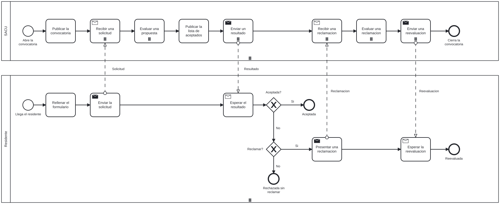

# Modelador BPMN

Editor web para el simulador Python de `../Backend`. Permite crear y abrir diagramas BPMN/XML, editar propiedades de simulación, usuarios y roles, guardar el diagrama con **Ctrl+S** y consultar el resultado textual de una simulación.

## Uso

Desde esta carpeta, con Node.js 18.12 o superior y npm instalados:

```sh
npm install
npm start
```

La aplicación se abre en `http://localhost:9000`. **Open Existing Model** abre un archivo local; también se puede arrastrar un BPMN al lienzo. **Simular** envía las reglas y el XML a `http://localhost:3000/simulate`. El Backend debe estar ejecutándose para simular. **Última simulación** muestra el último resultado correcto de la sesión, y **Reproducir** lo reproduce sobre el diagrama (ver [La reproducción](#la-reproducción)). Los tiempos de las tareas, la frecuencia y los temporizadores se expresan en segundos.

El resultado de una simulación es **un registro XES por pool** (ver abajo); **Ctrl+S** guarda el diagrama.
Lo guarda con formato, un elemento por línea, como Camunda Modeler; hasta la
5.6 lo guardaba en una sola línea, y cualquier cambio dejaba ilegible la
diferencia entre dos versiones del fichero. Al simular se manda ese mismo
texto.

Durante una ejecución se desactiva el botón de simulación. Los errores de
validación, ejecución, conexión o tiempo máximo aparecen en la interfaz y no
reemplazan el último resultado correcto. El límite predeterminado del Backend
es de 5 minutos; el editor consulta su configuración antes de cada ejecución.
Si el Backend ignora algo para poder simular (por ejemplo, un flujo por defecto o
un pool externo), los avisos aparecen encima del resultado.

## El proceso base

`ejemplos/proceso-base.bpmn` es la convocatoria del plan dibujada en el Modeler:
la SACU, que la orquesta, y diez residentes que solicitan, esperan su resultado
y, si no los aceptan, pueden reclamar. Para simularla basta con abrirla
(**Open Existing Model**) y pulsar **Simular**; no hace falta ningún fichero de
reglas, porque el Modeler las exporta del dibujo, y la semilla va guardada en
él.



El resultado son dos registros, **SACU** con un caso y **Residente** con diez,
de la simulación con semilla 20260101 del modelo «Proceso base». Con la fecha
de inicio predeterminada del Backend, la convocatoria acaba a las 00:05:57
(t=357 s): quedan aceptados ocho residentes, uno se rechaza sin reclamar y otro
reclama y recibe su reevaluación. Es exactamente la simulación del modelo de
referencia `35-proceso-base` del banco, y el banco lo comprueba
(`Backend/pruebas/integracion.py`).

### Dibujarlo desde cero

Todo se hace con la paleta, el menú de reemplazo de cada elemento (la llave
inglesa) y los paneles; los tiempos van en segundos.

1. **Open New Model**, borra el evento de inicio y crea dos pools con
   **Create pool/participant**, en la paleta: **SACU** arriba y **Residente**
   abajo.
2. Dibuja en cada pool sus eventos, tareas y compuertas, y únelos como en la
   imagen. Las tareas de envío y recepción se cambian de tipo con la llave
   inglesa (**Send task**, **Receive task**). Los nombres se escriben con doble
   clic. El ID, en **General**, es lo que los registros escriben en cada
   evento (`concept:name`); el ejemplo usa IDs legibles, como
   `Publicar_Convocatoria`, pero no hace falta.
3. Une con flujos de mensaje cada envío con su recepción en el otro pool:
   **Solicitud** (Enviar la solicitud → Recibir una solicitud), **Resultado**
   (Enviar un resultado → Esperar el resultado), **Reclamacion** (Presentar una
   reclamacion → Recibir una reclamacion) y **Reevaluacion** (Enviar una
   reevaluacion → Esperar la reevaluacion).
4. En cada tarea, en **Simulation parameters**, quién la hace (**Add User
   Task**) y sus tiempos. A las seis con multiinstancia en la tabla, la llave
   inglesa y **Parallel multi-instance**: son las que trabajan por lotes, una
   vez por solicitud o por reclamación.

   | Pool | Tarea | Tipo | Quién | Mínimo | Máximo | Multiinstancia |
   | --- | --- | --- | --- | --- | --- | --- |
   | SACU | Publicar la convocatoria | Task | Ana, Bea, Carlos | 10 | 10 | |
   | SACU | Recibir una solicitud | Receive | Ana, Bea, Carlos | 1 | 1 | paralela |
   | SACU | Evaluar una propuesta | Task | Ana, Bea, Carlos | 20 | 60 | paralela |
   | SACU | Publicar la lista de aceptados | Task | Ana, Bea, Carlos | 10 | 10 | |
   | SACU | Enviar un resultado | Send | Ana, Bea, Carlos | 1 | 2 | paralela |
   | SACU | Recibir una reclamacion | Receive | Ana, Bea, Carlos | 1 | 1 | paralela |
   | SACU | Evaluar una reclamacion | Task | Ana, Bea, Carlos | 20 | 40 | paralela |
   | SACU | Enviar una reevaluacion | Send | Ana, Bea, Carlos | 1 | 2 | paralela |
   | Residente | Rellenar el formulario | Task | Residente | 10 | 30 | |
   | Residente | Enviar la solicitud | Send | Residente | 1 | 1 | |
   | Residente | Esperar el resultado | Receive | Residente | 1 | 1 | |
   | Residente | Presentar una reclamacion | Send | Residente | 5 | 15 | |
   | Residente | Esperar la reevaluacion | Receive | Residente | 1 | 1 | |

   Con mínimo y máximo iguales, o con el máximo vacío, la tarea dura siempre
   lo mismo: el mínimo, redondeado al segundo. El motor simula cada duración
   en segundos enteros (ver los parámetros del panel, más abajo); en el
   proceso base todos los tiempos son enteros, así que cada tarea dura
   exactamente lo que dice.
5. En cada salida de las dos compuertas, en **SequenceFlow properties**, su
   **Percentage of Branches**: en «Aceptada?», 60 por «Si» y 40 por «No»; en
   «Reclamar?», 50 y 50.
6. A los dos pools, la llave inglesa y **Participant multiplicity**, y en
   **Model properties**:
   - SACU: **Orchestration role** Orchestrator, **Instances** 1 (una
     convocatoria) y sus tres personas (**Add User without Role**).
   - Residente: Orchestrated, **Instances** 10 (residentes por convocatoria),
     **Infinite resources** —cada residente se hace sus tareas: nadie espera
     a otro—, **Arrival mode** Uniform y **Arrival window T** 120 —cada uno
     llega en un segundo al azar entre 0 y 120 desde que se abre la
     convocatoria— y la persona Residente.
7. En la raíz —un clic en el lienzo vacío—, en **Model properties**: **Model
   name** «Proceso base», **Number of instances** 1 y **Seed** 20260101.
8. **Ctrl+S** lo guarda y **Simular** lo simula.

Con la misma semilla, la simulación depende también del orden en que se
dibujan dos cosas: los pools y las salidas de cada compuerta. El motor recorre
los elementos en el orden en que el Modeler los guarda, que es en el que se
crearon, y en ese orden reparte los números al azar. El ejemplo tiene la SACU
antes que los residentes y, en cada compuerta, la salida «Si» antes que la «No»;
dibujado así, en cualquier orden lo demás, da exactamente su XES, y en otro
orden, otra simulación igual de válida. Sin semilla, cada simulación es otra y
la usada queda en los registros.

El fichero abre sin avisos en otras herramientas: el banco lo abre como lo
abren bpmn-js sin nada del Modeler y Camunda Modeler (Camunda 7 y 8), lo vuelve
a guardar desde ellas sin perder nada y lo valida contra el esquema de BPMN 2.0
(`Backend/pruebas/valida_bpmn.mjs` y `valida_esquema.py`).

## Compilación

```sh
npm run lint
npm run bundle
```

La compilación genera exclusivamente `example/dist`; conserva los HTML y fuentes de `example`. Para servir la compilación, publica toda la carpeta `example`. `npm run all` revisa el código con ESLint y compila.

Las pruebas del Modeler están en el banco del Backend: el código de `lib/` lo
prueban sin navegador `valida_bpmn.mjs`, `exporta_reglas.mjs` y
`linea_de_tiempo.mjs`, y en un Chromium de verdad, la interfaz `interfaz.mjs`
(ver [el banco](../Backend/pruebas/README.md#la-interfaz)) y lo que dibuja el
visualizador `capa_de_dibujo.mjs`, `escena.mjs`, `zonas.mjs` y `colores.mjs`.
Para estas hace falta, una vez, `npx playwright install chromium`, que
descarga el Chromium de Playwright.

## Estructura

- `ejemplos`: diagramas dibujados y guardados con el Modeler; hoy, el
  proceso base (ver arriba).
- `example/src`: inicio y editor; al pulsar **Simular**, `taskHandlers.js`
  exporta las reglas con `lib/rules`, y `replay.js` es la barra de
  reproducción.
- `provider` y `descriptors`: propiedades de simulación y su serialización BPMN.
  El pool guarda en el `.bpmn`, con el prefijo `participantWithoutLane`, los
  mismos atributos que lleva en las reglas: `frequency` (número, admite
  decimales), `instances` (entero; las del orquestador son convocatorias
  sucesivas y las de los demás pools, casos por convocatoria), `orchestrationRole`
  (`orchestrator` u `orchestrated`), `infiniteResources` (booleano), `arrivalMode`
  (`staggered`, `simultaneous` o `uniform`) y `arrivalWindow` (entero, la T de la
  llegada uniforme). El marcador de multiplicidad es el estándar,
  `bpmn:participantMultiplicity`. Se editan en el panel del pool (ver abajo) y
  se exportan a las reglas (ver más abajo).
- `lib/logs`: los registros de una simulación, uno por pool, y el nombre de
  fichero de cada uno.
- `lib/numbers`: cómo validan, leen y muestran los números los paneles.
- `lib/rules`: el exportador de las reglas que se mandan al simular.
- `lib/people`: dónde se guardan las listas de personas (ver abajo) y la
  migración de los ficheros anteriores a la 5.2.
- `lib/resize-all-rules`: regla de redimensionado del editor.
- `lib/timeline`: la línea de tiempo del visualizador, desde los registros (ver
  abajo).
- `lib/drawing`: la capa de dibujo del visualizador, marcas sobre el lienzo
  (ver abajo).
- `lib/scene`: las pelotas de los casos, los sobres, las tres zonas de cada
  tarea, el color de cada caso, la plantilla de cada pool y el reloj del
  visualizador (ver abajo).
- `lib/player`: lo que se reproduce y en qué instante —convocatorias, filtro
  de casos, resumen y reloj—, sin dibujar nada (ver abajo).

### Parámetros de simulación en el panel

Al seleccionar un **pool**, con carriles o sin ellos, el panel muestra:

| Campo | Qué es | Se guarda como |
| --- | --- | --- |
| Orchestration role | Orquestador, orquestado o sin rol | `orchestrationRole` |
| Instances | Con el orquestador, convocatorias sucesivas; con los demás, casos por convocatoria. Solo cuenta con el marcador de multiplicidad, que se pone desde el menú de reemplazo del pool (la llave inglesa, **Participant multiplicity**) | `instances` |
| Infinite resources | Sus tareas no compiten por una persona | `infiniteResources` |
| Arrival mode | Escalonada (una cada *frequency* segundos), simultánea (todas al abrirse la convocatoria) o uniforme (cada una en un segundo entero al azar entre 0 y T) | `arrivalMode` |
| Frequency (s) | Segundos entre llegadas de la escalonada; admite decimales | `frequency` |
| Arrival window T (s) | La T de la uniforme, en segundos enteros | `arrivalWindow` |

Frequency solo aparece con la llegada escalonada y T con la uniforme; en el
orquestador, que tiene un caso por convocatoria y llega al abrirse, no aparece
ninguno de los tres. Un valor puesto donde no cuenta se sigue mostrando, para
poder quitarlo. Los pools sin carriles tienen además su lista de personas.

En la **raíz** —la colaboración, o el proceso si el diagrama es uno solo— está
la **semilla** (`collab:seed` o `model:seed`), junto al número de instancias de
la colaboración, o al del proceso y su frecuencia. La colaboración tiene además
ahí su nombre, **Model name**, que los registros guardan como `model:name`: el
panel **General** de bpmn-js no lo ofrece para una colaboración, y sin él el
modelo se exportaba como `Unnamed`. Con la semilla vacía, el motor genera una y
la deja en los registros; con la misma semilla y el mismo modelo sale la misma
simulación. Se guarda como texto para que una semilla grande no pierda cifras.

Cada campo se valida como lo valida el Backend (enteros donde hacen falta,
nada negativo, T obligatoria con la llegada uniforme, instancias obligatorias
con el marcador, semilla entre 0 y 9007199254740991): lo que no vale se marca
en rojo y no se guarda. También los tiempos de una tarea, **Minimum time** y
**Maximum time** (5.6): segundos, con decimales, y el mínimo no mayor que el
máximo; iguales valen. Los decimales se guardan en el `.bpmn` y llegan a las
reglas tal cual, pero el motor simula cada ejecución en segundos enteros (1.2):
la duración sale entre el mínimo y el máximo y se redondea al segundo más
próximo —en un empate, al par: con 2.5 y 2.5 la tarea dura siempre 2 s, y con
3.5 y 3.5, 4 s—, y si el mínimo es mayor que cero nunca baja de 1 s. Un tiempo
con decimales cambia cómo se reparten las duraciones entre los dos extremos
—cómo se sortean, en [el README del Backend](../Backend/README.md#ejecución-y-soporte)—,
no la precisión de cada una. Hasta la 5.6 el panel exigía el máximo
estrictamente mayor, avisaba con una ventana emergente y guardaba igual lo que
marcaba como inválido; y como el descriptor los leía como enteros, un 2.5
guardado volvía como 2 al abrir el fichero: cambiaba el modelo, no solo la
duración simulada. Los enteros llegan como mucho a 9007199254740991, el
mayor que JavaScript guarda exacto. Las frecuencias admiten también notación
científica, porque es como JavaScript las escribe en el `.bpmn` por debajo de
1e-6 y desde 1e21 —0.0000001 se guarda como `1e-7`—; al mostrarlas, el panel
las escribe sin exponente siempre que puede hacerlo sin perder nada.

El porcentaje de una rama de una compuerta, **Percentage of Branches** (5.6),
es un número de 0 a 100, con decimales. Como en el Backend, no hace falta que
las ramas de una compuerta sumen 100: debajo del campo, el panel dice cuánto
suman y qué hará el simulador —repartir en proporción lo que no suma 100 y
avisar, o dar a las ramas sin porcentaje lo que falta hasta 100—. Además de lo
que pase de 100, solo no se guarda lo que el Backend rechazaría: que ninguna
rama de la compuerta se pueda elegir, todas a 0. Hasta la 5.6 el panel exigía
que sumaran 100, lo marcaba en rojo pero lo guardaba igual, y se quedaba con la
parte entera: 33.3 se guardaba como 33.

Al simular, estos parámetros van en las reglas (ver abajo) y en el diagrama. El
Backend lee además del diagrama la semilla, y lo que unas reglas no digan; si
reglas y diagrama dicen cosas distintas, rechaza la simulación nombrando el
pool y los dos valores.

### Los registros de una simulación

Una simulación correcta devuelve **un registro XES por pool** (D10), y la
ventana de resultados los ofrece por separado: una fila por pool, con su
nombre, cuántos casos tiene y el fichero con el que se descarga, y los botones
**Ver** —enseña ese registro debajo de la tabla— y **Descargar**. **Descargar
todos** los descarga uno detrás de otro; el navegador puede pedir permiso para
descargar varios ficheros. Encima de la tabla están la identificación de la
simulación, la semilla —con ella se repite— y el modelo, y los avisos si los
hay. **Última simulación** vuelve a abrir esa ventana.

Cada fichero se llama como su pool, `Cliente.xes`. Si el pool no tiene nombre,
se usa su ID; si dos pools comparten nombre, los dos llevan además su ID,
`Cliente (Pool_Cliente).xes`. Lo que Windows no admite en un nombre —`/`,
`:`, `?`…, o un punto al final— pasa a `_`, y a un nombre de dispositivo
reservado —`CON`, `AUX`, `NUL`, `COM1`…— se le antepone `_`. Windows los
reserva también con extensión, porque mira lo que hay antes del primer punto:
un pool «Aux. mantenimiento» se descarga como `_Aux. mantenimiento.xes`, y
«CON.txt» como `_CON.txt.xes`. El registro dice
dentro de qué pool es (`pool:id`, `pool:name`) y de qué simulación
(`simulation:id`), así que un fichero renombrado se sigue pudiendo identificar.
Un registro muy grande se enseña solo por el principio, para no bloquear la
página; la descarga es siempre el registro entero.

Los ficheros se guardan en UTF-8. Hasta la 5.5 no era así con nada que
descargara el Modeler: `downloadjs` escribía un byte por carácter en cuanto
había uno entre `\x80` y `\xff`, así que una «ó» o una «ñ» en un nombre dejaban
el `.bpmn` guardado con **Ctrl+S** imposible de leer. Ahora se le pasa el texto
ya codificado.

### La línea de tiempo

El visualizador (hito 6) reproduce una simulación solo con sus registros
(D15). `lib/timeline` los convierte en su línea de tiempo:
`timelineFromLogs(logs)`, con los registros como los devuelve el Backend, da
cada evento como una pieza —una ejecución o una espera con su intervalo real,
o un instante por el que el caso pasa sin quedarse—, y `at(t)` da en cualquier
instante lo que tiene activo cada caso: varias piezas si hay ramas paralelas o
ejecuciones simultáneas de una tarea multiinstancia.

| Campo | Qué es |
| --- | --- |
| `id` | El caso y su `bpmn:occurrence`: no se repite aunque la tarea vuelva en un bucle o la recorran dos ramas a la vez |
| `case`, `pool`, `instance`, `call` | El caso, su pool, su número y su convocatoria |
| `element`, `type` | El ID BPMN del elemento y el tipo del evento |
| `state` | `working`, `waiting-user`, `waiting-message`, `waiting-data`, `waiting-join`, `timer` o `instant` |
| `execution` | El número de la ejecución en su activación |
| `activation` | La identidad registrada de la activación de la tarea; `null` en registros antiguos o elementos sin ella |
| `request` | La solicitud que atiende: el caso que la pidió |
| `sender`, `target`, `user` | Quién mandó el sobre, a quién va y quién hace la tarea |
| `origin`, `destination` | De qué elemento viene el sobre que recibe una recepción, y a cuál va el que manda un envío |
| `flows` | Las salidas que tomó una compuerta, o la entrada por la que espera una unión |
| `cancelled` | Una espera de una recepción multiinstancia que se canceló al cerrar esta |
| `start`, `end` | Segundos desde la fecha de inicio de la simulación, los que escribió el motor |

Un intervalo está activo desde su inicio hasta justo antes de su fin: cuando
una pieza acaba y la siguiente empieza en el mismo instante, en ese instante
está la siguiente. `passedBetween(a, b)` da los instantes entre dos momentos
(excluye `a`, incluye `b`), también las ejecuciones o esperas cuyo inicio y
fin coinciden: conservan su identidad, estado y orden, sin añadir duración.
`statusOf(caso, t)` indica si el caso aún no ha llegado, está vivo o ha terminado,
y `changes()` enumera los instantes en que cambia algo. `pools` trae cada pool
con lo que dice la cabecera de su registro: su nombre, su rol, si sus recursos
son finitos o infinitos (`resources`), su plantilla entera (`staff`, también
quien no llegó a trabajar; `null` si el registro no la trae), sus carriles con
su carril padre y sus personas (`lanes`) y, en un Process, sus roles (`roles`);
`pool(id)` da uno. `only(casos)` da la línea de tiempo de solo esos casos
—una convocatoria (6.7)—, con los mismos pools. El tránsito por los flujos es
cosmético y no está en la línea (6.3). Tampoco hay esperas por un tope de
concurrencia: el motor no tiene topes, y lo que espera una ejecución
multiinstancia es a una persona libre de su pool. El banco la comprueba con
todos los registros de referencia (`Backend/pruebas/linea_de_tiempo.mjs`).

### La capa de dibujo

`lib/drawing` es donde el visualizador dibujará sobre el diagrama (6.2): un
módulo de diagram-js que se añade en `additionalModules` y se usa como el
servicio `drawingLayer`. `addMark(id, opciones)` pone una marca SVG en el
elemento de ese ID BPMN —en el centro de su caja o en otra ancla: `top`,
`bottom-left`…—, y si el elemento es un flujo, a una fracción de su
recorrido (`fraction`), girada como su tramo si se pide (`rotate`), que es lo
que necesita el tránsito cosmético de la 6.3. `draw(grupo)` dibuja la marca;
sin él, un círculo. Cada marca se puede mover a otro elemento (`moveTo`) o
quitar (`remove`); `positionOf` y `pointAlong` dan los mismos puntos sin
dibujar nada.

Las marcas van en una capa del propio lienzo, dentro del grupo que bpmn-js
transforma al ampliar, reducir y arrastrar, y en coordenadas del diagrama: por
eso siguen pegadas a su elemento sin recalcular nada. Si el elemento se mueve
o su flujo cambia de recorrido, la marca se coloca otra vez; si se borra, se
oculta, y vuelve con él al deshacer. Las marcas van por ID: si el elemento
cambia de ID —el campo ID del panel General—, la suya se oculta, porque ya no
hay ningún elemento con ese ID, y vuelve a su sitio al deshacer el cambio. Al
abrir otro diagrama se quitan todas.
No capturan el ratón: el diagrama se selecciona y se edita a través de ellas.
El banco lo comprueba en un Chromium de verdad
(`Backend/pruebas/capa_de_dibujo.mjs`). La usa la escena (abajo); ninguna
página todavía: el modo de visualización es de la 6.7.

### La pelota del caso y el sobre

`lib/scene` (6.3) dibuja con la capa de dibujo lo que hay en un instante. Tiene
dos partes: `scene.js`, sin nada del navegador, saca la escena de la línea de
tiempo y de los flujos del diagrama —`createScene(timeline, graph)`, con el
grafo de `graphFromRegistry(elementRegistry)` si el diagrama está abierto o de
`graphFromBpmn(xml)` si es un `.bpmn`—, y `view.js` es un módulo de diagram-js,
el servicio `sceneView`: `load(timeline)` le da la simulación del diagrama
abierto, y `show(t, { transit })` dibuja el instante `t` y devuelve su escena.
Al abrir otro diagrama, o con `clear()`, quita las marcas y el reloj y descarga
la simulación: `show` da error hasta que se cargue la del diagrama nuevo, en vez
de dibujar sobre él la del anterior.

- **La pelota** es una ejecución o una espera activa de un caso, y lleva el
  número del caso dentro de su pool. Un caso con dos ramas paralelas, o con
  las diez ejecuciones de un lote, tiene varias pelotas a la vez, todas con su
  número; la escena cuenta aparte los casos de cada pool (`cases`), una vez
  cada uno. Trabajando, el borde es continuo; esperando —a una persona, un
  mensaje, unos datos o la otra rama—, discontinuo. En una tarea, cada pelota
  va en su zona (abajo); en una compuerta o un evento, alrededor de su centro,
  en el orden de sus casos.
- **El sobre** es un mensaje: sale cuando acaba su envío y lo recoge la
  recepción de su caso destino, al acabar la espera que terminó con él o, si
  ya estaba allí, al activarse. Las piezas de cada ejecución de una recepción
  van seguidas —esperar el sobre, esperar a una persona, trabajar—, así que la
  recogida es cuando empieza la espera de persona que acaba al empezar la
  recepción, o, si no la hubo, cuando empieza la recepción. No vale la última
  espera de mensaje anterior: dos activaciones de la misma recepción numeran
  las dos su ejecución desde 1, y la espera de la segunda puede acabar antes de
  que empiece la recepción de la primera, que ya tenía su sobre (el `37` del
  banco). Mientras tanto está en el buzón, encima de la recepción, en fila por
  orden de llegada. Cada envío se empareja con su
  recepción por el elemento que envía y el que recibe, el caso remitente y el
  destinatario, en orden, porque el buzón de un caso es una cola; su ID es el
  de la ejecución que lo envía, así que dos sobres de los mismos casos no se
  confunden. Lleva debajo los números de su remitente y su destinatario,
  «1→2», con el del caso cuya solicitud es en negrita: los tres que manda el
  orquestador 1 en una convocatoria son «1→2», «1→3» y «1→4». El mensaje es el
  de su flujo.
- **El tránsito** es cosmético (D15): con `transit`, en segundos simulados, una
  pelota que acaba de llegar a un elemento se dibuja ese tiempo sobre el flujo
  por el que llegó —como mucho la mitad de su estancia, para que se la vea
  llegar—, y un sobre que acaba de salir, sobre su flujo de mensaje. No cambia
  ningún elemento, estado ni recuento: en `t` cada pelota está ya en su
  elemento. Como depende solo de `t`, saltar a un instante da el mismo dibujo
  que llegar a él reproduciendo. Con `transit` 0, que es lo que se da si no se
  dice, no hay tránsito.
- **El reloj**, encima del lienzo, marca siempre el instante simulado:
  `t = 60 s · 2026-01-01 00:01:00`, con la fecha de inicio de la simulación y
  su desfase horario.

Cada pelota y cada sobre es una marca que se reutiliza de un instante a otro:
solo se mueve lo que cambia. Las marcas no capturan el ratón, así que su
título, con el caso, la ejecución, el estado y la solicitud, no aparece al
pasar por encima; está para las pruebas y los lectores de pantalla. El color
de cada caso es de la 6.5 (abajo) y la página que lo usa, de la 6.7. El banco
lo comprueba con todos los registros de referencia y en un Chromium de verdad
(`Backend/pruebas/escena.mjs`).

### Las tres zonas de cada tarea

Una tarea con algo se parte en tres franjas (6.4, `lib/scene/zones.js`): a la
izquierda, la **cola** a la entrada; en el centro, lo que está **dentro**; y a
la derecha, lo **bloqueado** a la salida. Todo sale de los intervalos de los
registros:

- **En la cola**, las piezas que esperan para hacer la tarea —a una persona,
  su sobre o unos datos—, y en su buzón, encima, los sobres que esperan a que
  una recepción los recoja.
- **Dentro**, las ejecuciones que trabajan.
- **A la salida**, las ejecuciones ya terminadas de una activación que aún no
  ha salido de la tarea: en un lote paralelo, las que acabaron y esperan a las
  demás; en un lote en secuencia o en un bucle estándar, las vueltas ya hechas
  mientras se hace la siguiente. Los registros no distinguen un bucle de un
  lote en secuencia —en los dos, ejecuciones seguidas con el número
  creciente—, así que se dibujan igual. La activación sale cuando acaba la
  última de sus ejecuciones, o la espera que se cancela al cerrar una
  recepción multiinstancia, y entonces su salida se vacía.

El número de ejecución no distingue dos lotes que llegan a la misma tarea:
ambos empiezan por 1. El formato 2 del XES añade `bpmn:activation` a las
ejecuciones y esperas de cada tarea, incluidas las canceladas. La escena agrupa
por caso, elemento y activación, y dentro por ejecución, sin deducir los lotes
por sus tiempos. Así separa también dos lotes paralelos que empiezan a la vez.

Cada zona tiene sus recuentos (`zones` en la escena de cada instante): cuántas
**ejecuciones** hay en ella, de cuántos **casos** —dos ramas o diez
ejecuciones del mismo caso son un caso—, de cuántos casos son las
**solicitudes** que tienen ya en la mano —esperando a una persona, trabajando
o terminadas; no las que esperan un sobre que aún no ha llegado— y, en la cola
de una recepción, cuántos **sobres** hay en su buzón. Cuentan lo que hay, no lo
que se ve: una pelota o un sobre en tránsito ya están en su zona y en su
buzón.

Las pelotas de cada zona se reparten en filas en su franja, y debajo va su
nombre: «cola», «dentro», «salida». Si son más de las que caben —en una tarea
de 100 × 80, ocho; dentro de una tarea de un pool con recursos finitos, donde
cada pelota lleva debajo a su persona (6.6), seis—, o del umbral que se le dé a `show(t, { threshold })` —un
número, también escrito como texto; uno mayor de lo que cabe deja que se
salgan de la franja—, una **insignia** las sustituye, también a las que llegan
en tránsito: el número de ejecuciones, «ejec.», cuántos casos y,
si las hay, de cuántos casos son sus solicitudes —«49 ejec. 1 caso 49 sol.» a
la salida de Recoger con N = 50—. El buzón, si sus sobres no caben en una fila
o pasan del umbral, es un sobre con la cuenta: «× 36», contando los que aún
van de camino, que se siguen dibujando sobre su flujo de mensaje. Las compuertas y los
eventos no tienen zonas; pasadas cuatro pelotas, o el umbral, también una
insignia. Las franjas se miden con el tamaño que tiene la tarea al dibujar el
instante, y una pelota que termina pasa de dentro a la salida en la misma
marca.

Mientras una tarea tiene marcas, su nombre se muestra en un rótulo con fondo
encima de ella; si se recortaría por el borde superior del lienzo, se coloca
debajo. Los buzones quedan por encima del rótulo superior. El nombre conserva
su tipografía y saltos de línea, se actualiza al editar y se restaura al salir
de la tarea o limpiar la escena. Esto no modifica el BPMN guardado.

Los registros antiguos siguen usando la reconstrucción por tiempos. Si se
detectan varias cadenas o activaciones candidatas, se pide volver a simular
para obtener `bpmn:activation`, en vez de escoger una arbitrariamente.
El banco comprueba los recuentos contra el XES, en todos los modelos de
referencia, y el dibujo en un Chromium de verdad (`Backend/pruebas/zonas.mjs`).

### El color de cada caso

Cada caso tiene su color (6.5, `lib/scene/colors.js`), **constante de
principio a fin**: no cambia con lo que haga, ni con la zona en la que esté, ni
al terminar. Va por el número del caso dentro de su pool, así que dos casos del
mismo pool nunca lo comparten, y el caso 1 de cada pool tiene el mismo: se
distinguen por el pool en el que están. Lo llevan:

- **todas sus pelotas**, también las de sus ramas paralelas y las de las
  ejecuciones de un lote: el número va encima en negrita, en la tinta —oscura o
  blanca— que mejor se lee sobre el color;
- **los sobres de los que es la solicitud**, el número en negrita debajo del
  sobre: una conversación va en un solo color, ida y vuelta —la petición del
  cliente 1 y la respuesta que le manda el servicio 1, las dos del color del
  cliente 1—, y los avisos de una convocatoria, en el del orquestador;
- **una insignia de un solo caso**, con su color aclarado de fondo —las del
  lote del SACU 1, en el del SACU 1—, y **un buzón lleno de una sola
  solicitud**, que es un sobre, en el suyo. Si son de varios, blancos.

Los ocho primeros colores son la paleta categórica de referencia de la guía de
visualización, en su orden, validada contra el fondo blanco del lienzo. A
partir del noveno se generan en OKLCH, en la misma banda de luminosidad y
croma, de modo que cada uno se distinga del anterior —al menos 15 de
distancia con visión normal y 8 con daltonismo rojo o verde, en OKLab × 100— y
ninguno se repita. Con muchos casos los colores se parecen cada vez más: lo que
identifica al caso sigue siendo su número, en la pelota y en el sobre, y el
color ayuda a seguirlo. En vez de colorear la resolución —aceptada,
rechazada—, el color identifica al caso; la rama que toma se ve por dónde va
su pelota. El banco lo comprueba en un Chromium de verdad
(`Backend/pruebas/colores.mjs`).

### El orquestador y sus recursos, por nombre

Junto a cada pool, el visualizador dibuja su **plantilla** (6.6,
`lib/scene/staff.js`): la que guarda la cabecera de su registro
(`pool:staff`), con todas sus personas —también las que no llegan a trabajar,
como Hugo en el modelo 39 o Diana, de reserva, en el 08— y el carril de cada
una. **No sale de las reglas**: si después se cambia el diagrama —se quita a
alguien de un pool, se borra un carril, se cambia quién hace una tarea o el
nombre del pool—, la plantilla sigue siendo la de cuando se simuló.

En cada instante, cada persona está **libre** u **ocupada**: con qué tarea,
para qué solicitud —o, si no la hay, qué caso— y en qué ejecución, con un
punto del color de esa solicitud, el de sus sobres. Una asignación es la
ejecución que nombra a la persona (`bpmn:userTask`): la toma al empezar a
trabajar y la suelta al acabar, en los instantes que escribió el motor, y
lleva el ID de la ejecución, su solicitud y su intervalo. Al soltar una
ejecución y tomar otra en el mismo instante, la persona aparece con la nueva.
Debajo, la **cola del pool** (D4): lo que espera a una persona, de cualquier
tarea, por orden de llegada; se nombran cinco, y de las demás se dice cuántas
son. Una espera cancelada al cerrar un lote espera un mensaje, así que no está
en la cola ni ocupa a nadie. Con recursos infinitos no hay cola, y cada persona
dice cuánto atiende a la vez.

La plantilla va a la derecha del pool, arriba, si cabe ahí **sin tapar nada del
diagrama** —otro pool, un elemento o un rótulo— ni otra plantilla. Si no, se
desliza por ese lado, y después prueba a la izquierda, debajo y encima, siempre
pegada al pool: con dos pools uno al lado del otro, la del de la izquierda va a
su izquierda. Si no queda sitio en ningún lado, va a la derecha, por debajo de
lo que la taparía. Se coloca con el tamaño mayor que llega a tener en la
simulación —con su cola más larga—, así que no cambia de sitio de un instante a
otro; se vuelve a colocar si se mueve o cambia algo del diagrama. En un
Process, que no tiene pool, va junto a todo el diagrama.

En las tareas de un pool con recursos finitos, **cada pelota que trabaja lleva
debajo a la persona que la atiende** y, en negrita, el número de la solicitud,
con el color de esa solicitud: en el 39, a los 40 s, las cinco evaluaciones
simultáneas dicen «Ana 5», «Bea 1», «Carlos 2», «Dani 3» y «Eva 4». Las filas
se separan para que quepa y se quedan por encima del marcador de
multiinstancia. Al terminar, la pelota pasa a la salida sin nombre: la
persona ya está libre. En un pool con recursos infinitos la persona nunca deja
de estar disponible —atiende a la vez todo lo que la nombra, y la plantilla
dice cuánto—, así que sus pelotas no la llevan.

`scene.at(t).staff` da, por pool, las personas con su estado y sus
asignaciones y la cola; `scene.staff.assignments`, todas las asignaciones.
Encajar el diagrama —`zoom('fit-viewport')`— no tiene en cuenta lo dibujado;
`sceneView.fit()` encaja también las plantillas y los nombres de las tareas.
El banco lo comprueba contra el XES y en un Chromium de verdad
(`Backend/pruebas/plantilla.mjs`).

### La reproducción

**Reproducir**, activo en cuanto hay una simulación, la reproduce sobre el
diagrama abierto (6.7) y abre una barra debajo del lienzo, a la derecha de la
paleta; mientras está abierta, los botones de simular se ocultan, y **Salir**
la cierra, borra lo dibujado y devuelve el foco a **Reproducir**. Una
simulación es del diagrama que se simuló: abrir otro cierra la barra, y
**Reproducir** no se vuelve a activar hasta simularlo —sus registros se siguen
viendo en **Última simulación**—, tampoco si se abre mientras el Backend aún
está simulando el anterior: entonces el estado lo dice. Mientras se simula,
tampoco se puede reproducir. En la barra:

- **Reproducir** y **Pausa**, con la **velocidad** en segundos simulados por
  segundo real (× 1 a × 100; de entrada, la menor que reproduce la
  convocatoria en unos 40 s); **⏮** vuelve al principio, y **◀** y **▶**
  saltan al instante anterior o siguiente en que cambia algo.
- La **barra de tiempo**, para arrastrar, y el **instante exacto**: se
  escribe, con **Ir** o Intro se salta a él sin redondear, y fuera de la
  ventana se queda en su borde. Mientras no se escribe en él, sigue al reloj,
  redondeado a milésimas, y **Ir** no mueve nada.
- La **convocatoria**, si hay varias, o **Todas**: es el **alcance** de la
  reproducción. La barra va de su principio a su fin, y todo lo que se dibuja
  y se cuenta —pelotas, sobres, insignias, buzones, plantillas y su cola,
  resumen— es solo de sus casos: la escena se hace con la línea de tiempo de
  la convocatoria (`timeline.only`). Las rondas van seguidas, así que en el
  último instante de una la siguiente ya ha empezado; con la primera del `31`,
  a los 88 s todos han terminado, nadie está ocupado y la cola está vacía,
  aunque Ana ya trabaje para el orquestador 2.
- Los **casos que se ven**, dentro de la convocatoria: por pool, sus números
  —«1-3, 7»—; vacío, todos. Se ocultan las pelotas de los demás y los sobres
  que no van entre dos casos que se ven, pero **ningún recuento cambia**: las
  insignias, los buzones, las plantillas y el resumen siguen siendo los de la
  convocatoria. Un filtro que no se entiende se marca, se explica y no
  filtra.
- Debajo, el **resumen** de cada pool en ese instante: cuántos casos están en
  curso, cuántos por llegar y cuántos han terminado, de todos los de la
  convocatoria, y, con un filtro, cuántos se ven.

Cada instante se dibuja entero desde la línea de tiempo (`lib/player`,
`lib/scene`), sin depender de lo que se dibujó antes. El reloj avanza desde su
último punto de partida —al reproducir, al saltar o al cambiar de velocidad—,
sin ir sumando pasos, así que en pausa el instante es exactamente aquel en el
que se paró o al que se saltó (queda en `data-t` de la barra). Mientras se
reproduce, las pelotas y los sobres recorren sus flujos —el tránsito, que es
cosmético—; en pausa, cada uno está donde está en ese instante, así que pausar
en t y saltar a t dan el mismo dibujo. Lo único que se ve distinto mientras se
reproduce es eso: una pelota que acaba de llegar viene por su flujo, y un
sobre que acaba de salir recorre el suyo aunque ya esté recogido o cuente ya en
un buzón lleno. Al abrir
la barra, el diagrama se encaja con las plantillas, en lo que dejan libre la
paleta y la barra (`sceneView.fit(padding, margins)`). El banco lo comprueba
con el Modeler compilado, en un Chromium de verdad, con el reloj de la página
en la mano (`Backend/pruebas/reproduccion.mjs`).

### Las reglas que se mandan al simular

**Simular** manda al Backend el diagrama tal como se guarda y sus reglas: una
línea por elemento dibujado, con sus parámetros de simulación. Las exporta
`lib/rules`, sin nada del navegador, para que el banco del Backend
(`Backend/pruebas/exporta_reglas.mjs`) pueda exportar con el mismo código. Las
líneas salen en el orden en que bpmn-js pinta los elementos, que es el que usa
el motor.

Cada tarea lleva quién la hace, sus tiempos y, si tiene la marca,
`multiInstanceType` (`"false"` la paralela, `"true"` la secuencial). Cada pool
lleva `frequency`, siempre `participantMultiplicity` —`"true"` o `"false"`,
según tenga el marcador—, y los parámetros del panel que estén puestos:
`instances`, `orchestrationRole`, `infiniteResources`, `arrivalMode` y
`arrivalWindow`. Con eso las reglas se bastan solas: el banco comprueba que,
con el diagrama y sin él, dan el mismo XES que las reglas de referencia de cada
modelo con la misma semilla. La semilla no va en las reglas: la lee el Backend
del diagrama.

### Multiinstancia

Una tarea multiinstancia lleva la marca estándar de BPMN, no un tipo propio: se
pone desde el menú de reemplazo de la tarea (la llave inglesa), con **Parallel
multi-instance** o **Sequential multi-instance**, y se quita volviendo a pulsar la
que está activa. Se guarda como `bpmn:multiInstanceLoopCharacteristics`
—`isSequential="true"` en la secuencial—, se exporta a las reglas como
`multiInstanceType="false"` o `"true"`, y el Backend también la lee del diagrama
(3.1). La paralela es la de los lotes de la convocatoria (D8): enviar a N,
recoger de N y evaluar N. **Loop** no es multiinstancia: es el bucle estándar
(`bpmn:standardLoopCharacteristics`) y se configura con sus parámetros de bucle.

### Las listas de personas en el `.bpmn`

Quién puede hacer cada tarea y la plantilla de cada carril, pool y proceso se
guardan dentro de `bpmn:extensionElements`, que es el sitio que BPMN 2.0 reserva
a las extensiones, un elemento por persona:

| Dónde | Elemento |
| --- | --- |
| Tarea | `<user:userTask>`: una persona o un rol |
| Carril | `<lane:userWithoutRole>` |
| Pool sin carriles | `<participantWithoutLane:userWithoutRole>` |
| Proceso | `<model:userWithoutRole>`, y cada rol en un `<model:keyValuePair>` con `<model:key>` (el rol) y `<model:value>` (sus personas, separadas por comas) |

Así el fichero cumple el esquema de BPMN 2.0, y otras herramientas lo abren sin
avisos y lo vuelven a guardar sin perder las listas; el banco lo comprueba con
las librerías con las que abre un fichero Camunda Modeler
(`Backend/pruebas/valida_bpmn.mjs`) y contra el esquema
(`Backend/pruebas/valida_esquema.py`). Hasta la 5.1 eran elementos hijos directos de la tarea, el carril, el
pool o el proceso; esos ficheros se siguen abriendo: al abrirlos, las listas
pasan a `extensionElements` (se ve en la consola del navegador) y se guardan ya
en su sitio. Los descriptores conservan las propiedades antiguas
(`UserTask`, `userWithoutRole`, `userWithRole`) solo para poder leer esos
ficheros; los paneles y la exportación de las reglas usan `lib/people`.

El modelador ya no incluye chatbot, mapa de calor, biblioteca de animación de tokens ni Scheduler/CSV. Los archivos con Scheduler se rechazan al importarlos para evitar interpretarlos como tareas ordinarias. Usuarios y roles se conservan.

El Backend recibe las reglas y devuelve un registro XES por pool en `logs` y
los avisos en `warnings`. Valida también el XML original para detectar funciones BPMN no soportadas;
el mensaje identifica el elemento que necesita revisión. Poder editar un
elemento no implica que el simulador lo implemente. Consulta el alcance en
[Backend/README.md](../Backend/README.md). Chatbot, mapa de calor y Scheduler ya
no se ejecutan en el servidor.
